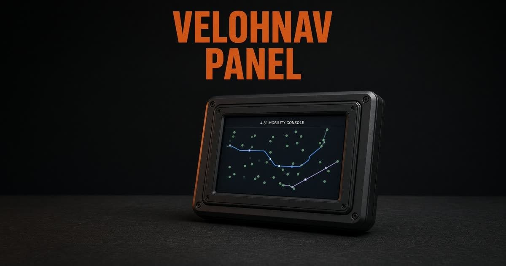
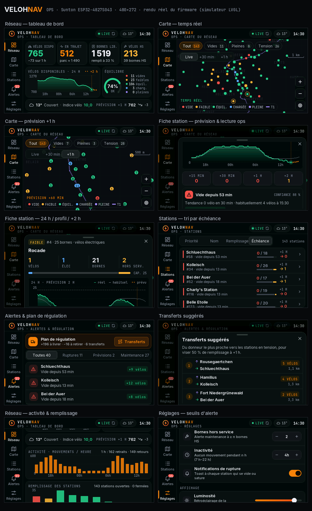
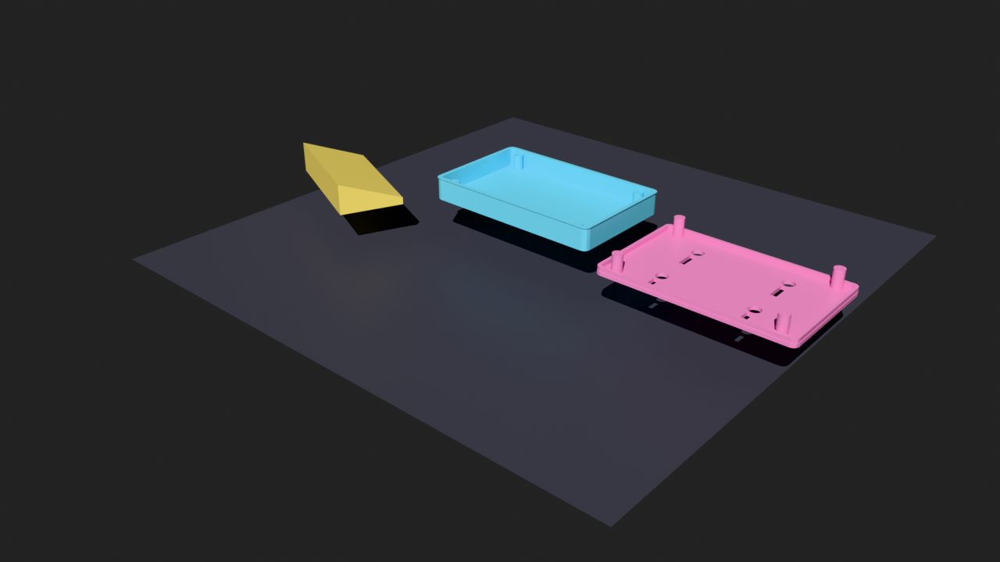
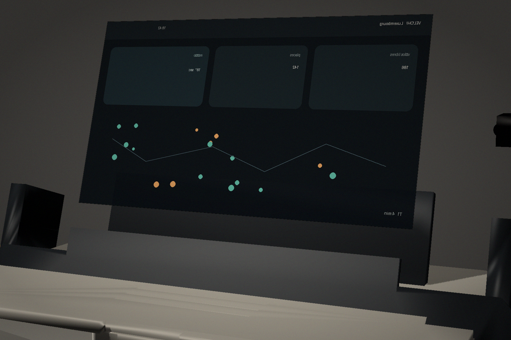
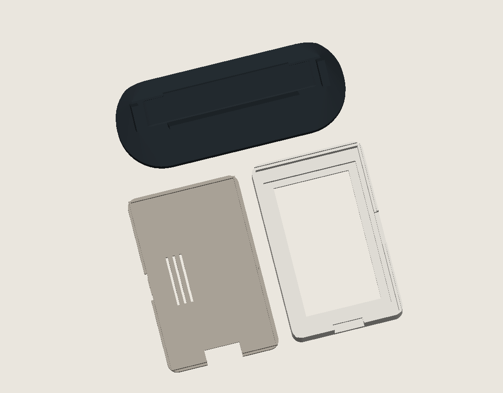

# VelohNav Ops — supervision temps réel du parc Vel'OH!

[](https://github.com/Silexperience210/sunton-4827s043-desk-monitor/actions/workflows/build.yml)

Firmware pour l'écran tactile **Sunton ESP32-4827S043** (ESP32-S3, 4,3" 480×272) qui transforme la
visualisation de [VelohNav](https://github.com/Silexperience210/velohnav) en **poste de contrôle du
réseau Vel'OH!** : disponibilités en direct, historique 24 h, prévisions à 2 h, alertes, plan de
régulation et transferts suggérés. L'AR, la navigation et l'assistant IA de l'app mobile sont retirés ;
tout le reste est réorienté exploitation.





> Les captures sont rendues par le **code réel du firmware** (même UI LVGL) dans le simulateur PC,
> avec un instantané **réel** des flux Vel'OH! (13/10/2026, 14 h 30). Seuls l'historique 24 h et les
> profils y sont synthétiques ; sur l'appareil, ils s'apprennent en temps réel.

---

## Écrans

| Onglet | Contenu |
|---|---|
| **Réseau** | Vélos disponibles (et variation sur 1 h), vélos en trajet (estimation) et parc, bornes libres et taux de remplissage, vélos/bornes hors service · courbe 24 h + prévision 2 h en pointillés · jauge d'équilibre et répartition vides / faibles / équilibrées / chargées / pleines · météo + indice vélo · prévision réseau à +1 h · activité horaire (retraits/retours) · histogramme du remplissage · priorités d'intervention |
| **Carte** | Carte dessinée (sans tuiles) : quadrillage métrique, tracé du tram T1, quartiers, stations colorées sur l'axe *vide → pleine* · horizon **Live / +30 min / +1 h** (la carte montre où le réseau *sera* en tension) · filtres Tout / Vides / Pleines / Tension · glisser pour déplacer, double-tap ou +/− pour zoomer (au zoom : nombre de vélos dans chaque pastille) · anneau ambre = station sans mouvement suspect |
| **Stations** | Les 143 stations, triables par priorité, nom, remplissage ou échéance de rupture · vélos / bornes, barre de composition, prévision à +1 h |
| **Alertes** | Plan de régulation (vélos à livrer / à retirer), transferts suggérés, filtres Ruptures / Prévisions / Maintenance · badge rouge sur le rail = stations vides ou pleines · notification à chaque nouvelle rupture |
| **Service** | La vue du directeur de service : disponibilité du jour et sur 30 jours (« 97,3 % · 54 671 h sur 56 211 h », parts vide / pleine / hors service nommées — une station vide n'est pas hors service), ruptures et saturations par jour sur 30 jours, comparaison à la semaine précédente et au même jour de la semaine dernière · **problèmes récurrents** (« Vide 8 h–9 h · 10 jours ouvrables sur 10 · série 12 j », règle affichée, fériés rangés avec le week-end) · 5 pires et 5 meilleures stations · état de la carte (fraîcheur des flux, Wi-Fi, mémoire, apprentissage). Définitions et mesures : [`docs/vue-service.md`](docs/vue-service.md) |
| **Réglages** | Wi-Fi (recherche + clavier), fréquence de rafraîchissement, seuils d'alerte, luminosité et atténuation nocturne, état de l'apprentissage, test et étalonnage du tactile, mémoire / stockage / redémarrage |

Un tap sur une station (carte, liste, alerte) ouvre sa **fiche** : statut, vélos / élec / bornes / HS,
courbe 24 h réelle + profil habituel + prévision 2 h, prévisions +15 min / +30 min / +1 h / +2 h,
lecture opérationnelle (« Rupture prévue dans ~25 min », tendance, comportement habituel), action
conseillée (« Apporter +6 vélos »), confiance du modèle, dernier mouvement, adresse.

## Ce qui est repris de VelohNav

- **Design system v4** à l'identique : jetons de `src/ui/tokens.js` / `ui.css` (noir #07090B, surfaces
  s1–s3, orange #F5820D, vert/ambre/rouge d'état, bleu élec, violet transport), typo sans **Inter** +
  mono **JetBrains Mono**, en-tête `VELOHNAV`, pastilles, chips à compteur, contrôle segmenté animé,
  badges, barres de composition, bottom sheet, toasts, bandeau hors ligne, cartes « dcard » et tuiles
  de prévision, logo roue + éclair en dégradé.
- **Icônes** : le jeu SVG de `src/ui/icons.jsx` converti en images LVGL (+ quelques icônes ops dans le
  même style).
- **Données** : flux GBFS v3 cyclocity et logique de `src/utils/gbfs.js` (stations fantômes et
  « BORNE ATELIER » exclues, `is_renting` / `is_returning`, types électriques).
- **Prédiction** : principe de `useAvailability.js` (moyenne plafonnée par jour × quart d'heure).
- **Météo** : note « conditions vélo » de `src/ui/weather.js` (pénalités pluie / vent / froid / orage,
  aggravation et accalmie sur +1…+3 h).

Adaptations : barre d'onglets → **rail vertical** (écran paysage de 272 px de haut), filtres orientés
exploitation, axe de couleur *vide → pleine* (les stations pleines comptent autant que les vides).

## Prévisions : méthode

Pour chaque station, à l'horizon *h* (0 à 120 min) :

```
prévu(h) = actuel + c · [profil(t+h) − profil(t) + part météo(h)] + (1 − 0,6·c) · tendance(h)
```

- **profil** : vélos attendus selon le jour de la semaine et le quart d'heure, appris en continu
  (moyenne mobile plafonnée ≈ 8 semaines par créneau, lissage ±15 min). Tant qu'un créneau est jeune,
  il emprunte aux jours du même type (lun–ven / sam–dim) : les prévisions deviennent utiles dès le
  2ᵉ jour au lieu de la 2ᵉ semaine.
  Un **jour férié** légal luxembourgeois (fêtes fixes, lundi de Pâques, Ascension, lundi de Pentecôte)
  se prévoit et s'évalue avec le profil du **dimanche**, et l'écran le dit (« jour férié : profil du
  dimanche ») ; le lendemain reprend le profil de son propre jour.
- **tendance** : régression sur les 30 dernières minutes, amortie (τ = 25 min).
- **c** : confiance (0 → 1) selon le nombre d'observations ; affichée dans les fiches.
- **part météo** : quand le temps est pire que la normale de l'heure (pluie, vent > 20 km/h, froid,
  neige, orage — les barèmes de l'indice vélo), le mouvement attendu du profil est freiné d'un
  coefficient **appris sur le parc** (fenêtres de 30 min, météo observée), appliqué seulement s'il
  dépasse 3 erreurs-types ; part bornée à ± 40 % de la capacité. Météo actuelle sur 2 h, météo
  annoncée jusqu'à 6 h, rien au-delà ; sans météo (absente ou de plus de 45 min), aucune part.
  La fiche dit la part et son origine (« appris », « pas encore appris », « non mesurable »,
  « météo indisponible »). Le gain, ses limites et les leviers écartés sont **mesurés** dans
  [`docs/mesures-prevision.md`](docs/mesures-prevision.md).

On en déduit l'**échéance** de rupture / saturation, le **besoin** (vélos à apporter ou retirer pour
viser 50 % de remplissage à +1 h), la **priorité** de chaque station et des **transferts** (chaque
station en tension est servie par le donneur le plus proche). La prévision réseau est la somme des
prévisions des stations.

L'historique 24 h (avec la météo de chaque tranche de 5 min) et les profils (avec l'apprentissage
météo) sont sauvegardés en flash toutes les 30 min (LittleFS) et restaurés au redémarrage ; les
fichiers d'une version antérieure sont relus, ceux d'un format inconnu ignorés. Au tout premier démarrage, seule la tendance est disponible : les prévisions s'affinent
jour après jour (progression visible dans **Réglages → Prédiction**).

## Matériel

**Sunton ESP32-4827S043** en version **N16R8** (16 Mo flash, 8 Mo PSRAM octale) :

| Version | Tactile | Environnement PlatformIO | Binaire |
|---|---|---|---|
| **ESP32-4827S043C** (la plus courante) | capacitif GT911 | `esp32-4827s043c` | `dist/velohnav-ops-esp32-4827s043c-v1.0.6.bin` |
| ESP32-4827S043R | résistif XPT2046 | `esp32-4827s043r` | `dist/velohnav-ops-esp32-4827s043r-v1.0.6.bin` |
| C monté tête en bas | capacitif, rotation 180° | `esp32-4827s043c-180` | — |

Brochage (dans `src/hal/board.h`), recoupé avec deux références indépendantes
([ESP3D-TFT](https://esp3d.io/esp3d-tft/version_1x/hardware/esp32-s3/sunton-43-4827/) et
[rzeldent/esp32-smartdisplay](https://github.com/rzeldent/esp32-smartdisplay)) :

| Fonction | GPIO |
|---|---|
| Dalle RGB565 : DE / VSYNC / HSYNC / PCLK | 40 / 41 / 39 / 42 |
| Données B0…B4 | 8, 3, 46, 9, 1 |
| Données G0…G5 | 5, 6, 7, 15, 16, 4 |
| Données R0…R4 | 45, 48, 47, 21, 14 |
| Rétroéclairage (PWM) | 2 |
| GT911 (version C) : SDA / SCL / RST / INT | 19 / 20 / 38 / 18* |
| XPT2046 (version R) : SCLK / MISO / MOSI / CS / IRQ | 12 / 13 / 11 / 38 / 18 |

\* Sur la version C, l'interruption du GT911 n'est reliée à GPIO 18 qu'après une modification
(pont sur R17). Le firmware n'en a pas besoin : il interroge le contrôleur en I2C toutes les 16 ms
et accepte ses deux adresses possibles (0x5D / 0x14). Les coordonnées du GT911 correspondent
directement aux pixels (aucune inversion d'axe sur cette carte) ; si le contrôleur est configuré
pour une autre résolution, elle est lue au démarrage et mise à l'échelle.

## Vérifier le tactile

**Réglages → Système → Tactile → Tester** : une croix suit le doigt et affiche les coordonnées écran et
brutes. Si elle n'apparaît pas exactement sous le doigt, **Étalonner** : toucher successivement
4 cibles dans les coins puis une au centre (contrôle de précision ; refusé au-delà de 20 px).
L'étalonnage détecte seul un axe inversé ou des axes échangés et s'enregistre en flash ;
**Usine** revient à la correspondance d'origine.

- Si le tactile est trop décalé pour atteindre les boutons : **maintenir le doigt 6 s n'importe où**
  ouvre le test, puis **maintenir 3 s** sur l'écran de test lance l'étalonnage.
- Version R (résistive) : l'étalonnage s'ouvre automatiquement au premier démarrage.

## Installation

### A. Binaire prêt à flasher (le plus simple)

Télécharger le binaire de sa version de carte :
[version C (capacitif)](https://github.com/Silexperience210/sunton-4827s043-desk-monitor/raw/main/dist/velohnav-ops-esp32-4827s043c-v1.0.6.bin) ·
[version R (résistif)](https://github.com/Silexperience210/sunton-4827s043-desk-monitor/raw/main/dist/velohnav-ops-esp32-4827s043r-v1.0.6.bin)

**Sans rien installer (Chrome ou Edge)** :

1. Brancher la carte en USB-C et ouvrir <https://espressif.github.io/esptool-js/>.
2. « Connect » et choisir le port de la carte (souvent « USB-SERIAL CH340 »).
3. « Erase Flash » (efface l'ancien programme ; ~30 s).
4. Dans la ligne « Flash Address », mettre **0x0** (et non 0x10000), choisir le fichier `.bin`, puis « Program ».
5. **Débrancher puis rebrancher le câble** (ou appuyer une fois sur **RST**) : sans cela, la carte reste
   en mode flashage et l'écran reste noir.

En ligne de commande :

```bash
pip install esptool
esptool.py --chip esp32s3 --baud 460800 erase_flash
esptool.py --chip esp32s3 --baud 460800 write_flash 0x0 dist/velohnav-ops-esp32-4827s043c-v1.0.6.bin
```

### Mise à jour d'une carte déjà en service (1.0.x → 1.1.0)

La 1.1.0 relit sans perte les profils et l'historique d'une 1.0.x, puis les réécrit dans un format plus
récent (`/vn_prof.bin` v4, `/vn_hist.bin` v2, nouveau `/vn_days.bin`) que **les 1.0.8 et 1.0.9 refusent**.
Revenir en arrière sans sauvegarde, c'est repartir d'un profil vide. Donc :

> **1.1.0 → 1.2.0 : aucune migration.** La 1.2.0 n'ajoute aucun format de fichier (`/vn_hist.bin`
> reste en v2) : elle se flashe par-dessus et retrouve l'historique, les profils et les résumés tels
> quels. C'est la 1.1.0 qui a introduit les formats actuels.

> **1.2.0 → 1.2.1 : aucune migration.** La 1.2.1 ne change que la recherche Wi-Fi (voir plus bas) :
> même flash par-dessus, mêmes fichiers relus à l'identique.

#### 1.2.1 — la recherche Wi-Fi fonctionne aussi sans réseau

Le pilote refuse tout balayage **pendant qu'une association est en cours**, et la carte, quand son
réseau enregistré est injoignable, passait son temps à s'associer : la recherche échouait alors
systématiquement, si bien qu'on ne pouvait plus découvrir — donc plus choisir — un autre réseau.
La recherche **suspend maintenant l'association le temps du balayage** puis la relance, et un refus
du pilote est réessayé au lieu d'être pris pour un échec définitif. Deux corrections liées :

- le réseau saisi à l'écran n'est **enregistré qu'une fois l'association réussie** : une faute de
  frappe ne devient plus le réseau du démarrage ;
- **plus de plantage à la validation du mot de passe** : la feuille et son clavier étaient détruits
  par deux suppressions différées, dans un ordre qui laissait le clavier écrire dans un objet déjà
  libéré — l'écran redémarrait avant toute tentative d'association, ce qui interdisait de changer de
  réseau ;
- le journal série ne dit plus « déconnexion … délai dépassé » quand la carte coupe elle-même pour
  changer de réseau ;
- le journal série dit ce qui s'est passé : `association suspendue`, `réseau enregistré : « X »`,
  `réseau « X » NON enregistré : l'ancien réseau reste celui du démarrage`.

Recette faite sur la carte : recherche associée (5 réseaux), changement pour « Bitcoin » avec
enregistrement après succès, mot de passe refusé (code 15) puis **recherche non associée réussie**
(`5 bornes, 4 réseaux listés … association suspendue puis reprise`), et retour au réseau enregistré.

1. **Sauvegarder la partition de fichiers** (lecture seule ; refuse d'écraser une sauvegarde, et vérifie
   la taille et le superbloc LittleFS — code de sortie ≠ 0 : ne pas flasher) :
   ```bash
   python3 tools/sauvegarde_littlefs.py sauver --port /dev/ttyUSB0 --sortie littlefs-avant.bin
   ```
2. Flasher **sans « Erase Flash »** : l'effacement détruit aussi la partition de fichiers. L'image fusionnée
   s'arrête vers 1,5 Mo et ne touche pas la partition (0xC90000) ; `pio run -t upload` non plus.
3. Retour arrière, si besoin : reflasher l'ancienne version, **puis**
   `python3 tools/sauvegarde_littlefs.py restaurer --port /dev/ttyUSB0 littlefs-avant.bin`.

### B. Compilation PlatformIO

```bash
pio run -e esp32-4827s043c -t upload
pio device monitor
```

### Premier démarrage

L'écran s'allume en moins d'une seconde et affiche chaque étape du démarrage. La toute première fois,
l'étape « préparation de la mémoire » peut durer jusqu'à 30 s (formatage du stockage interne).
Ensuite l'écran de configuration **Wi-Fi** s'ouvre : choisir le réseau, saisir le mot de passe,
valider (✓). Pour pré-remplir les identifiants, copier `include/secrets.h.example` en
`include/secrets.h`. L'heure est synchronisée par NTP (fuseau Luxembourg, heure d'été gérée), puis
les stations s'affichent en quelques secondes. Si le réseau enregistré est injoignable, l'écran Wi-Fi
se rouvre de lui-même. La recherche fonctionne **même sans aucune association** (carte neuve, réseau
absent, mot de passe erroné) : l'association est suspendue le temps du balayage puis reprise, donc on
peut toujours découvrir un autre réseau et en changer.

## Boîtier imprimé 3D (bureau ou mural)

Boîtier pour la carte, à poser sur un bureau (avec cale inclinée) ou à fixer au mur.



- **Deux usages** : moniteur de bureau (avec la cale) ou afficheur mural.
- **Découpe USB-C latérale** : centrée verticalement sur le côté gauche par défaut.
- **Paramétrable** : source OpenSCAD fournie, facile à adapter si votre révision de carte a l'USB ou
  les boutons ailleurs.

### Cotes utilisées

D'après la fiche constructeur du module 4,3" ESP32-4827S043N/R/C :

| Élément | Valeur |
|---|---|
| Circuit imprimé | 123,0 × 74,0 × 1,6 mm |
| Module LCD | 105,5 × 67,2 mm |
| Zone d'affichage active | 95,04 × 53,86 mm |
| Trous de fixation | 4 × Ø3,2 mm, entraxe 105,5 × 67,2 mm |

> **Toujours comparer avec votre carte avant d'imprimer.** Les révisions varient (USB à gauche / à
> droite, en haut / en bas, ou centré).

### Fichiers

```
stl/
  front-case.stl    # façade + logement du circuit + découpe USB
  back-cover.stl    # capot arrière plat avec trous de fixation murale (en trou de serrure) + plots de vissage
  desk-stand.stl    # cale vissée sur le capot arrière pour l'usage bureau
  sunton-4827-stand.stl   # stand fermé : coque + capot clipsé + pied 18° (trois corps)

openscad/
  sunton-4827s043-desk-monitor.scad   # source paramétrable

tools/make_stand.py # source du stand fermé
render-preview.py   # génère docs/preview.png
```

### Réglages d'impression (Bambu P1S / FDM générique)

- **Matière** : PETG ou ABS/ASA (tenue à la chaleur près de l'ESP32).
- **Hauteur de couche** : 0,2 mm
- **Parois** : 3 périmètres
- **Remplissage** : 20 % gyroïde
- **Supports** :
  - `front-case.stl` : aucun (la fente USB est un court pont ; imprimer face ouverte vers le haut).
  - `back-cover.stl` : aucun s'il est imprimé à plat (trous de serrure et plots verticaux).
  - `desk-stand.stl` : aucun (plus grande face plane sur le plateau).

### Assemblage

1. Glisser l'ESP32-4827S043 dans la façade, écran vers l'extérieur.
2. Aligner les quatre trous de fixation du circuit sur les plots de la façade.
3. Poser le capot arrière et visser avec **4 vis auto-taraudeuses M2,5** (≈ 10 mm).
4. Usage bureau : visser la cale sur le capot arrière avec les mêmes trous.
5. Usage mural : retirer la cale et accrocher par les trous de serrure (vis M4 ou n° 6).

### Déplacer la découpe USB

Ouvrir `openscad/sunton-4827s043-desk-monitor.scad` et modifier :

```openscad
usb_side = "left";    // "left" ou "right"
usb_y    = 37.0;      // hauteur du centre depuis le bord haut du circuit (mm)
usb_w    = 13.0;      // largeur de la découpe
usb_h    = 6.0;       // hauteur de la découpe
```

Puis régénérer les STL (OpenSCAD ou `docker run openscad/openscad:latest`).

> Pour un affichage tête en bas dans le boîtier (USB du mauvais côté), flasher la variante
> `esp32-4827s043c-180` (voir « Matériel »).

## Stand fermé

La carte est entièrement enfermée (coque + capot clipsé) et se pose dans un pied à 18°.
La fiche USB-C se branche sur le côté gauche. La photo ci-dessous est une vue du STL, pas un objet déjà imprimé.



```
stl/sunton-4827-stand.stl
tools/make_stand.py
```

Régénérer (le script vit maintenant dans le dépôt, sorties relatives) :

```bash
python tools/make_stand.py      # réécrit stl/sunton-4827-stand.stl + docs/stand-*.png
```

Dépendances : `numpy`, `manifold3d`, `numpy-stl`, `Pillow`. Cotes en tête de fichier (jeu de montage,
épaisseurs, inclinaison, fenêtre d'affichage, fente USB). Le script **s'auto-contrôle avant d'écrire** :
interpénétration coque/capot, jeu du berceau, air d'une prise USB-C, crochement du clip — il s'arrête
si l'un de ces points est faux.

**Plateaux** : coque + capot tiennent sur **173 × 130 mm** ; le pied se place sur un second plateau
(**166 × 64 mm**).



**Contrôles du maillage** (le trancheur fait autorité) : `manifold = yes`, **3 parties**,
212 673 mm³ ; surplombs sous 45° **39,6 mm² (0,1 %)** — d'où l'absence de supports ; parois p05
**2,32 mm**, médiane 6,20 mm (le minimum mesuré, 0,85 mm, est la languette de clip : elle doit
fléchir). Les triangles dégénérés laissés par les soustractions coplanaires sont retirés à l'export,
sinon le trancheur compte une arête non-manifold.

Impression sans supports, couche 0,2 mm, 3 périmètres, 15 à 20 % de remplissage :

- coque : fenêtre contre le plateau
- capot : face extérieure contre le plateau, clips vers le haut
- pied : base contre le plateau

Les trois corps tiennent sur un plateau de 220 × 220 mm. Glisser la carte par l'arrière, écran vers la fenêtre, presser le capot jusqu'au clic, puis poser l'ensemble dans le pied, USB à gauche. Jeu de 0,5 mm. Cotes de la fiche constructeur : si l'USB est à droite, faire un miroir dans le slicer.

## Données et limites

- **Sources** : GBFS v3 public de cyclocity (`station_status` toutes les 60 s par défaut — réglable de
  30 s à 5 min — `station_information` toutes les heures, `vehicle_types` chaque jour) et Open-Meteo
  (toutes les 15 min). Aucune clé d'API. Le firmware ne contacte que ces deux services et NTP.
- **Vélos en trajet** : le flux GBFS **ne contient pas cette donnée** (ses seuls champs sont
  `num_vehicles_available`, `vehicle_types_available`, `num_vehicles_disabled`, `num_docks_available`,
  `num_docks_disabled`, `is_installed` / `is_renting` / `is_returning`, `last_reported`). C'est donc
  une **estimation** : maximum des vélos en station observé sur 24 h, moins les vélos actuellement en
  station. Ce maximum n'a de sens que s'il vient du **creux de nuit** (01 h–05 h), seul moment où la
  quasi-totalité du parc est en station ; tant qu'aucune nuit n'a été observée, le tableau de bord
  affiche **« — »** et « estimation après une nuit » plutôt qu'un zéro trompeur. Le parc et l'heure de
  son pic sont affichés dès que l'estimation est valable. Même logique pour la variation sur 1 h et
  l'activité (retraits / retours) : elles demandent une heure de relevés, sinon l'écran le dit.
- **Retraits / retours** : déduits des écarts entre deux relevés successifs ; c'est un minimum (deux
  mouvements qui se compensent entre deux relevés ne sont pas vus).
- **« Aucun mouvement »** : le champ `last_reported` du flux n'est pas fiable (la plupart des bornes y
  indiquent ~1 h du matin) ; la détection repose donc sur nos propres relevés (aucune variation pendant
  N heures, entre 7 h et 22 h).
- **Semaines** : au-delà des 24 h d'historique, la carte garde **un résumé par jour** (60 jours,
  `/vn_days.bin`) : par heure de service, le temps observé vide / plein / hors service et les entrées en
  rupture ou saturation, et par station les créneaux touchés. Les jours où la carte était éteinte ne
  comptent ni pour ni contre — l'écran Service dit combien de jours sont réellement relevés.
- **TLS** : les certificats ne sont pas vérifiés (`setInsecure`) — données publiques en lecture seule,
  aucun identifiant transmis.
- Les données internes JCDecaux (tickets de maintenance, trajets, parc exact) ne sont pas publiques.
  Pour les brancher, `src/core/gbfs.cpp` et `src/net/net_esp32.cpp` sont les deux points d'entrée.

## Simulateur et tests (PC)

Le dossier `sim/` compile **la même UI et le même cœur** que l'ESP32 avec LVGL 8.3, sans écran :

```bash
# dépendances : LVGL v8.3.11 et ArduinoJson v7 dans .deps/
git clone -b v8.3.11 --depth 1 https://github.com/lvgl/lvgl.git .deps/lvgl
git clone -b v7.4.2 --depth 1 https://github.com/bblanchon/ArduinoJson.git .deps/ArduinoJson
cd sim
make sim test_core bench_prevision dump_sim
./test_core ../docs/donnees     # 954 vérifications — ATTENTION : une vérification préexistante échoue
                                 # (« nuit en cours, relevé courant maximal », test_core.cpp:359), héritée
                                 # du changement de règle de validité de 46a944a : le test affirme l'ancienne
                                 # règle (nuit ⇒ valide), que « le quart le moins actif » a remplacée. À trancher,
                                 # pas à contourner. Les 953 autres passent.
                                 # ingestion, fraîcheur, provenance, prévision 24 h, écart au profil,
                                 # météo dans l'historique, coefficient météo appris, migration de /vn_hist.bin et /vn_prof.bin (v1, v2, v3 → v4),
                                 # écart habituel (dispersion apprise, affichée pour information, textes de l'écart),
                                 # jours fériés (calendrier sourcé, Pâques sur 12 années, profil du dimanche),
                                 # mémoire du profil (décroissance exacte, relecture d'un profil d'une autre mémoire),
                                 # liste Wi-Fi (tri, dédoublonnage, masqués, réessais, suspension de l'association),
                                 # vue Service (résumés par jour, disponibilité, détecteur de récurrent sur un monde
                                 # à vérité connue, /vn_days.bin : migration et fichiers abîmés),
                                 # vidage série « dump » (CRC32, base64, émetteur, lecteur de commandes)
./sim ../docs/donnees /tmp/captures   # scénario tactile, captures, audit des zones tactiles, étalonnage
./sim ../docs/donnees /tmp/boot boot              # premier démarrage : sans heure, sans Wi-Fi, sans données
./sim ../docs/donnees /tmp/boot2 boot-wifi-ko     # réseau enregistré mais injoignable
./sim ../docs/donnees /tmp/totaux totaux          # totaux du tableau de bord, sans historique (audit des chiffres)
./sim ../docs/donnees /tmp/ops ops                # écrans d'exploitation : fraîcheur, provenance, ingestion, 24 h, « inhabituel »
                                 # ces écrans sont archivés dans docs/captures/ (24_…43_)
./sim ../docs/donnees /tmp/svc service            # vue Service : 4 semaines d'un monde à vérité connue sur les vraies
                                 # stations ; imprime vrais trouvés / faux positifs ; captures 48_…58_
./bench_prevision                # banc de la prévision : 143 stations et une météo simulées sur 168 jours,
                                 # MAE à +15…+120 min, alertes par jour de pluie / sec, maturation du profil
                                 # (méthode et chiffres : docs/mesures-prevision.md)
python3 ../tools/bench_grille.py --config "N12=profil_n=12" --config "N24=" --ref N24 --absorption   # grille de réglages appariés
../.venv/bin/python ../tools/test_carte_dump.py   # liaison « dump » simulée sur un pseudo-terminal (38 vérifications)
python3 ../tools/test_bench_reel.py              # banc --reel sur 9 semaines d'une « carte simulée » (28 vérifications, ~1 min)
```

### Données réelles de la carte : vidage série et banc `--reel`

La carte garde ce qu'elle apprend en flash : l'historique 5 min des **24 dernières heures**
(`/vn_hist.bin`), les **profils appris** (`/vn_prof.bin`, plusieurs semaines de mémoire) et les
résumés par jour (`/vn_days.bin`). La commande série **`dump`** les recopie vers le PC pour que le
banc les rejoue ; c'est ce qui permet de **re-tester sur le parc réel** les conclusions tirées du
monde simulé (`docs/mesures-prevision.md`, « Banc sur données réelles »).

```bash
# 1. sur le PC relié à la carte en USB (115 200 bauds) — pyserial vient avec PlatformIO
.venv/bin/python tools/carte_dump.py                    # /dev/ttyUSB0 ; --port, --baud, --sortie
# → ~/.hermes/cache/scratch/donnees-carte/archive/AAAAMMJJ-HHMMSS/{vn_hist.bin,vn_prof.bin,vn_days.bin,vn_stations.csv}
#   et une copie du dernier vidage à la racine de donnees-carte/
# 2. rejouer
cd sim && make bench_prevision
./bench_prevision --reel ~/.hermes/cache/scratch/donnees-carte/archive \
                         ~/.hermes/cache/scratch/donnees-carte/archive/<le plus ancien>/vn_prof.bin
./bench_prevision --reel <…>/archive <…>/vn_prof.bin --levier profil_n=12   # variante, appariée
```

- **Lecture seule, sans déranger la carte** : `dump` prend un instantané du modèle en mémoire sous
  le verrou (`Model::serialize`, les octets exacts de la prochaine sauvegarde, quelques ms), puis
  l'émet depuis une tâche de priorité 1, sous la tâche réseau ; **rien n'est lu ni écrit en flash**,
  rien n'est effacé, la carte ne redémarre pas. `stop` interrompt, `ping` répond `VNDUMP PRET`,
  `aide` liste les commandes. Environ **1 min** pour ~460 Ko (base64, blocs de 96 octets).
- **Protocole** (`src/core/dump.h`) : en-tête par fichier (nom, taille, nombre de blocs, CRC32),
  CRC32 par bloc, fin explicite par fichier et pour le tout. L'outil vérifie l'ordre des blocs, chaque
  somme, les tailles et la fin, réessaie une fois, et **n'écrit rien** si quoi que ce soit est faux (la
  capture de l'échec est gardée dans `donnees-carte/echecs/`). `--depuis capture.txt` relit une
  capture faite autrement (`pio device monitor`…).
- **Vidage chaque jour** : l'anneau ne garde que 24 h ; c'est l'**archive** des vidages successifs
  (fusionnés tranche par tranche par le banc) qui fait des semaines. Deux vidages par jour laissent
  de la marge (`0 6,18 * * *` en cron, une fois la première liaison vérifiée à la main).
- **Banc `--reel`** : rejoue en marche avant — le modèle ne voit que le passé, sa prévision est notée
  contre le relevé réel qui suit. Mêmes indicateurs qu'en simulation (MAE +15…+240 min, persistance,
  profil seul, fausses alertes / jour, rappel, maturation, absorption), comparaisons **appariées par
  jour** avec leur erreur-type, verdict « **trop court pour conclure** » sous 7 jours évaluables.
  Les tranches que le profil de départ a déjà apprises sont écartées (**fuite**) ; un vidage unique est
  rejoué quand même et le rapport le dit. La forme des profils appris est vérifiée (résidentiel qui se
  vide le matin, bureaux et écoles qui se remplissent, loisirs le week-end) et les stations qui
  contredisent leur nom, leur voisinage, ou dont le profil est toujours vide / plein / immobile sont listées.
- **Non vérifié** : la liaison série réelle (câble, CH340, circuit de réarmement de l'ESP32 : l'outil
  ouvre le port sans toucher à DTR/RTS et signale tout redémarrage vu), le débit réel, la tenue de la
  tâche sur la carte. Tout le reste est vérifié sans la carte : émetteur simulé sur pseudo-terminal
  (`sim/dump_sim`), et « carte simulée » vidée chaque jour (`bench_prevision --exporter <dossier>`).

`./sim <dossier-json> <sortie> totaux` imprime les totaux calculés par le **code du firmware**
(stations, vélos, bornes, HS, remplissage, parc, en-trajet, variation) avec les indicateurs de
validité : c'est l'outil d'audit des chiffres affichés — à confronter à un recalcul indépendant sur
le **même** instantané de flux (`docs/donnees/`, ou un relevé frais du GBFS).

`docs/donnees/` contient l'instantané des flux utilisé pour les captures.
`docs/audit_tactile.txt` liste les 392 éléments cliquables de tous les écrans et fiches : pour
chacun, un tap simulé à son emplacement doit atteindre cet élément (0 masqué, aucune cible
de moins de 24 px). Le simulateur éprouve aussi l'étalonnage sur un panneau résistif aux axes
échangés et en miroir (erreur résiduelle : 1 px).

### Fiabilité des chiffres

- **Provenance** : toucher une tuile du tableau de bord (ou le bandeau météo) ouvre une feuille qui
  donne, pour chaque chiffre, le champ exact du flux (`station_status.num_vehicles_available`,
  `current.temperature_2m`…) ou la règle de calcul, l'horodatage du flux et de sa réception, et pour
  les estimations la condition de validité. Une donnée absente s'affiche « — » avec sa raison.
  Les phrases vivent dans `src/core/ops.cpp` ; `test_core` recalcule chaque somme station par station.
- **Fraîcheur** : bandeau « Données vieilles de X min » quand le dernier `station_status` réussi
  dépasse le seuil (Réglages : auto = 3 × la période, 3 min au moins ; météo : 3 × 15 min).
- **Ingestion** (Réglages → Ingestion des flux) : par flux, dernier succès, dernier échec et son
  code, octets reçus, durée, échecs consécutifs ; NTP et Wi-Fi. Compteurs tenus par la tâche réseau.
- **Prévision 24 h** (fiche station → 24 h) : même règle que la prévision 2 h, prolongée sur le profil
  appris ; pointillés là où la confiance du profil est < 50 %.
- **« Inhabituel »** : écart entre la valeur courante et le profil appris au-delà d'une tolérance
  (règles en commentaire dans `src/core/model.cpp`, `anomalyStation`), silencieux hors 7 h–22 h et
  tant que le profil est trop jeune.

### Démarrage dans l'émulateur ESP32-S3

Le firmware compilé pour l'ESP32-S3 est aussi démarré dans [QEMU d'Espressif](https://github.com/espressif/qemu)
(à chaque push, en CI) : le test vérifie que le démarrage va jusqu'au bout sans plantage et capture
l'image affichée.

```bash
pio run -e test-qemu
python3 tools/qemu_boot_test.py --qemu /chemin/qemu-system-xtensa --build .pio/build/test-qemu --out qemu_out
```

L'environnement `test-qemu` sert uniquement à ce test (QEMU n'émule ni la PSRAM octale ni le
rétroéclairage PWM) : **ne pas le flasher sur la carte**.

## Structure

```
src/
  main.cpp                 boucle LVGL (cœur 1) + démarrage
  serial_cmd.cpp           commandes série (« dump » : données apprises vers le PC, lecture seule)
  boot.cpp                 écran de démarrage, cause du dernier redémarrage, mode sans échec
  config.h                 URLs, périodes, tailles d'historique
  core/                    modèle : GBFS, météo, historique, profils, prévisions, alertes, transferts
  ui/                      coquille (en-tête, rail, sheet, toasts), écrans, fiche station, Wi-Fi
  ui/widgets/              graphique sur mesure (aire en fondu, pointillés), carte du réseau
  ui/fonts, ui/icons       polices et icônes générées (tools/gen_fonts.sh, tools/gen_icons.mjs)
  hal/                     dalle RGB (esp_lcd), GT911, XPT2046, étalonnage tactile, brochage
  net/                     tâche réseau (cœur 0) : Wi-Fi, NTP, flux, sauvegardes
  platform/                abstraction ESP32 / simulateur
sim/                       simulateur headless + tests
tools/                     générateurs (polices, icônes, tracé du tram, planche d'aperçu), test QEMU,
                           vidage de la carte (carte_dump.py) et ses tests (test_carte_dump.py, test_bench_reel.py),
                           fusion des images dist/ (merge_dist.py) et contrôle de leur en-tête (check_dist_bin.py)
dist/                      binaires fusionnés prêts à flasher (adresse 0x0)
stl/, openscad/            boîtier imprimé 3D (STL prêts à imprimer + source paramétrable)
render-preview.py          rendu de l'aperçu du boîtier (docs/preview.png)
```

## Dépannage

- **Écran trop sombre après un flash** : depuis la 1.0.3, 80 % et plus restent au niveau continu du GPIO 2 (le PWM de cette dalle n'atteint pas ce niveau). En dessous, le curseur de réglages tamise vraiment.
  Si ça reste noir, ouvrir le série (115200). « PSRAM absente » = mauvaise variante de mémoire :
  N16R8 (16 Mo, PSRAM octale) → `esp32-4827s043c` ; ancienne carte 8 Mo en PSRAM quad →
  `esp32-4827s043c-qspi`. Puis RST ou débrancher le câble : sans ça la carte reste en mode flashage.
- **Écran allumé mais bloqué sur une étape** : l'étape affichée indique où ça coince ; le détail part
  sur le port série (115200 bauds) — par exemple avec la console de <https://espressif.github.io/esptool-js/>
  (bouton « Start » de la partie *Console*) ou `pio device monitor`.
- **Redémarrages en boucle dès que le Wi-Fi se connecte** : corrigé en 1.0.4. Les accesseurs Wi-Fi
  (SSID, IP, RSSI) étaient appelés dans une section critique, interruptions coupées : les deux cœurs
  se bloquaient sur le même verrou et le chien de garde d'interruption redémarrait la carte toutes
  les quelques secondes. Un journal série qui répète « chien de garde d'interruption » désigne cette
  famille de plantage — mettre le binaire à jour.
- **L'image `dist/` ne démarre pas (rien sur le série, ou `ets_loader.c 78`)** : son en-tête de
  bootloader doit être en **dio**, pas en qio — le ROM lit l'image de 0x0 avant de configurer la
  flash, une en-tête qio le fait échouer puis la carte boucle. `python3 tools/check_dist_bin.py
  dist/*.bin` le vérifie (et le job `binaires-publies` de la CI le contrôle à chaque push) ;
  régénérer avec `python3 tools/merge_dist.py --build .pio/build/<env> --out dist/<nom>.bin`.
- **« Redémarrage après un incident »** : la carte a planté ou s'est bloquée au démarrage précédent ;
  la cause et l'étape sont affichées pendant 6 s, puis le démarrage continue. Après 3 incidents de
  suite, le **mode sans échec** coupe le réseau (débrancher / rebrancher pour en sortir). « Chute de
  tension » = alimentation trop faible : autre câble ou chargeur 5 V / 2 A.
- **« PSRAM introuvable »** : la carte n'est pas une version N16R8 (8 Mo de PSRAM octale).
- **Image qui ondule ou se décale** pendant les accès Wi-Fi : baisser `LCD_PCLK_HZ` à 7 MHz dans
  `src/hal/board.h`.
- **Rouge et bleu inversés** (rare, selon le lot de dalle) : inverser les groupes R et B de
  `LCD_DATA_PINS`.
- **Tactile décalé** : Réglages → Système → Tactile → Étalonner (voir « Vérifier le tactile »).

## Crédits

Données Vel'OH! © JCDecaux via GBFS · météo [Open-Meteo](https://open-meteo.com) (CC BY 4.0) ·
tracé du tram T1 : ATP / data.public.lu (CC BY 4.0) · [LVGL](https://lvgl.io) (MIT) ·
[ArduinoJson](https://arduinojson.org) (MIT) · polices Inter et JetBrains Mono (SIL OFL 1.1) ·
interface, icônes et logique dérivées de VelohNav (Silexperience) · boîtier 3D : MIT — Silexperience 2026.
