# Régulation : le Sunton du camion, le téléphone de secours, le serveur

Ce document décrit les chantiers 1 et 2 de la [feuille de route](feuille-de-route.md) tels qu'ils sont
livrés : **interventions déclarées** et **tournées proposées**. Une seule règle les gouverne :

> Seul ce que le régulateur **valide** compte comme intervention. Rien n'est déduit du flux public :
> neuf personnes qui prennent neuf vélos ne sont pas un camion. Le flux sert seulement à **recouper**
> chaque arrêt déclaré, et les deux restent côte à côte, sans correction silencieuse.

## Qui fait quoi

| | rôle |
|---|---|
| **Serveur** | tient le registre (tournées, arrêts déclarés), calcule le plan de chaque camion toutes les 30 s, recoupe chaque arrêt avec le flux 10 min après, calcule les indicateurs |
| **Sunton du camion** (rôle « régulateur ») | montre le prochain arrêt, fait valider ce qui a vraiment été fait, garde tout en flash quand le partage de connexion coupe |
| **Téléphone** (`/regulateur.html`) | la même chose en secours, avec la même file hors connexion ; peut rejoindre la tournée du camion |
| **Tableau de bord** (onglet **Régulation**) | tournées en cours et leur plan, déclarations et leur recoupement, indicateurs, réglages |

## Mettre en route

1. **Sur le serveur**, tableau de bord → onglet **Régulation** → Réglages :
   - les camions et leur capacité (par exemple Kangoo 10, Master 25) ;
   - les régulateurs (prénoms) ;
   - l'atelier : nom, adresse pour mémoire, et le **point exact** — coller des coordonnées (`49.61, 6.05`) ou un
     lien OpenStreetMap / Google Maps qui contient les coordonnées. L'adresse seule n'est **jamais géocodée** :
     la rue des Romains est longue, quelques centaines de mètres changent l'ordre d'une tournée. Tant que le point
     manque, le plan ne propose pas d'arrêt à l'atelier ;
   - le stock prêt à l'atelier (vélos neufs ou réparés), **déclaré** : le flux ne voit pas l'atelier.
2. **Sur le Sunton du camion** : Réglages → Wi-Fi → le point d'accès du téléphone du régulateur ;
   Réglages → Synchro en ligne → l'adresse du serveur (et le jeton si `VN_TOKEN` est défini) ;
   Réglages → **Rôle de ce Sunton** → **Régulateur** (la carte redémarre ; l'onglet « Tournée » remplace
   « Réseau »). En série : `role regulateur`, `reg` pour l'état.
   La version **résistive** (`-r`) se manie avec des gants, la capacitive non.
3. **Sur le téléphone** : ouvrir `http://<serveur>:8790/regulateur.html` (jeton demandé s'il y en a un), l'ajouter
   à l'écran d'accueil.

## Une tournée

| | |
|---|---|
| 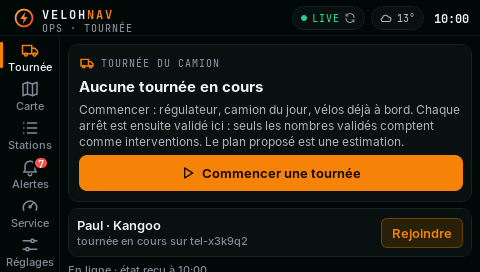 | **Commencer** : régulateur, camion du jour, vélos **déjà à bord** (en service, hors service). Une tournée ouverte sur un autre appareil (le téléphone) peut être **rejointe**. |
| 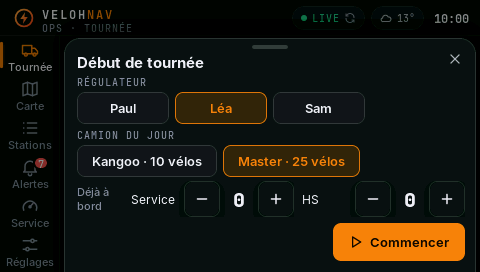 | Le départ est contrôlé comme sur le serveur : jamais plus que la capacité du camion. |
| 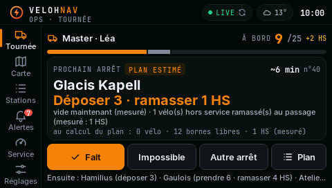 | **Prochain arrêt** proposé par le serveur, marqué **PLAN ESTIMÉ** : station, consigne (« Déposer 3 · ramasser 1 HS »), pourquoi (« vide maintenant (mesuré) », « risque de vide dès 10:31 (estimé, marge d'erreur comprise) »), état de la station au calcul (mesuré). En haut : à bord 9 / 25 + 2 HS. En bas : la suite du plan. |
| 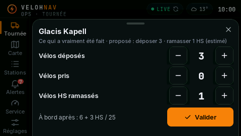 | **Fait** : les nombres proposés sont pré-remplis ; le régulateur confirme d'un toucher ou corrige avec − / + (appui long : ça défile). Le chargement après l'arrêt est calculé en direct ; une déclaration qui le rendrait négatif ou supérieur à la capacité est refusée **avec la raison**, jamais corrigée en silence. Ce que le plan proposait est gardé à côté du déclaré. |
| 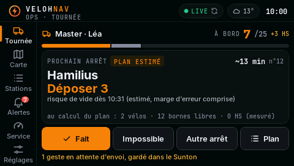 | L'arrêt disparaît du plan affiché aussitôt, même avant l'envoi ; « 1 geste en attente d'envoi, gardé dans le Sunton » tant que le serveur ne l'a pas reçu. |
| 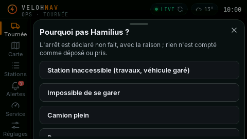 | **Impossible** : l'arrêt est déclaré non fait, avec la raison (station inaccessible, impossible de se garer, camion plein, bornes en panne, plus besoin, autre). Rien n'est compté comme déposé ou pris. |
| 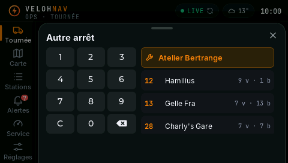 | **Autre arrêt** : l'atelier, ou une station par son **numéro** (pavé numérique). Sans numéro tapé, les stations les plus proches du prochain arrêt — le Sunton n'a pas de GPS, c'est la meilleure référence. |
| 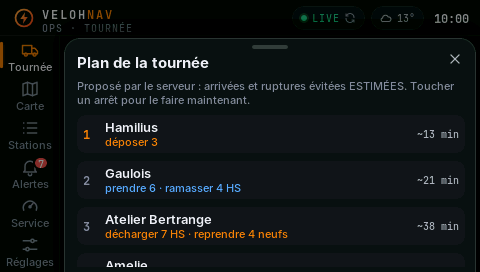 | **Plan** : tous les arrêts proposés (toucher pour faire celui-là maintenant : l'ordre reste au régulateur), puis… |
| 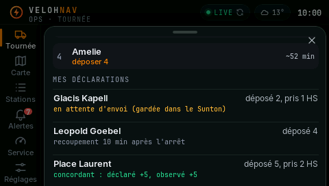 | … ses déclarations et leur **recoupement** : « concordant : déclaré +5, observé +5 », « écart : déclaré −6, observé −4 », « recoupement 10 min après l'arrêt », « arrêt non fait ». |
| 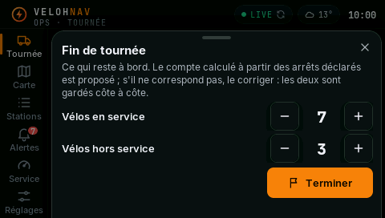 | **Fin de tournée** : le chargement restant calculé est proposé ; s'il ne correspond pas, le corriger — déclaré et calculé sont gardés côte à côte. |
| 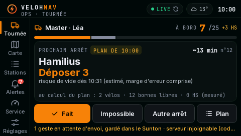 | **Hors connexion** : le plan reste affiché, daté (« PLAN DE 10:00 ») ; chaque geste attend en flash et part dans l'ordre au retour du réseau. Un redémarrage (contact coupé) ne perd ni la file ni le dernier plan. |
| 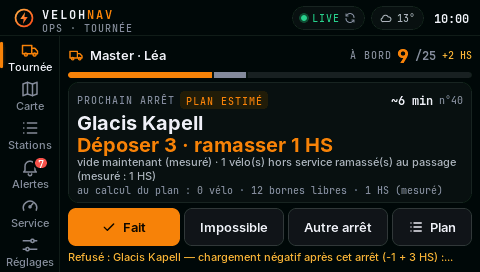 | Un **refus du serveur** (par exemple : le téléphone a déclaré entre-temps dans la même tournée) sort de la file avec la raison du serveur, affichée telle quelle. |
| 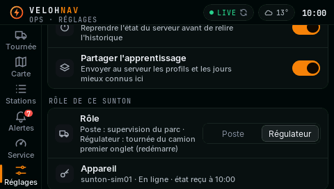 | Réglages → Rôle ; « Appareil » : le nom sous lequel le serveur voit ce Sunton et l'état de la liaison. |

Captures du simulateur (`sim/sim ../docs/donnees <dossier> regulateur`), état du serveur d'exemple.

## Ce qui est mesuré, déclaré, estimé

| chiffre | classe | d'où |
|---|---|---|
| vélos déposés / pris / HS ramassés, atelier, arrêts impossibles | **déclaré** | le régulateur, horodaté par son appareil |
| chargement à bord | **déclaré** | départ déclaré + somme des arrêts déclarés (calculé par le serveur) |
| état de la station à la réception de la déclaration | **mesuré** | dernier relevé du flux |
| recoupement (concordant / écart / non visible) | **déclaré recoupé avec le flux** | voir la règle ci-dessous |
| délai station vide → dépose | **déclaré + mesuré** | début de la rupture dans l'historique au pas de 5 min, heure de la dépose déclarée |
| plan : arrêts, nombres, arrivées, minutes de rupture évitées | **estimé** | prévision de la carte et sa marge d'erreur **mesurée** |

### Recoupement

Pour un arrêt en station déclaré à l'heure T, le serveur regarde le flux de la station sur
[T − 20 min, T + 10 min] (journal à la minute, sinon l'historique au pas de 5 min) et cherche la plus
forte variation dans le sens déclaré sur 6 min. **Concordant** si l'écart entre déclaré et observé est d'au
plus 1 vélo ou 25 %, **écart** sinon (les deux nombres sont montrés), **non visible** si la station n'a pas de
relevé autour de l'heure. L'atelier et les arrêts impossibles sont **hors flux**. Le verdict tombe 11 min
après l'arrêt.

Des déclarations faites sans vrais vélos (essais) sortent en **écart**, comme il se doit :
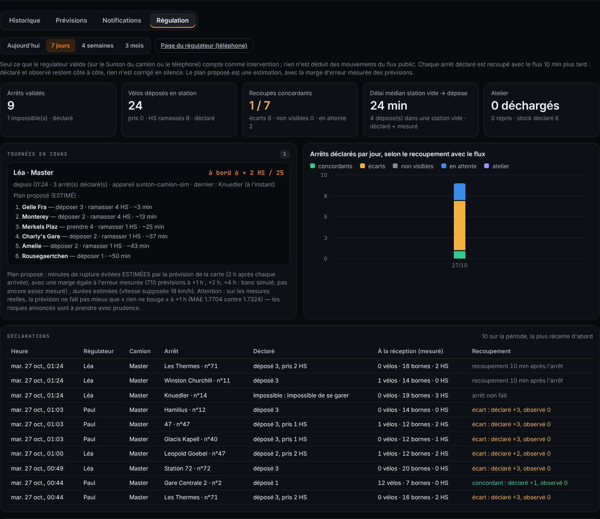
*Serveur d'essai : vrai flux, déclarations simulées — le recoupement les marque « écart : déclaré +3, observé 0 ».*

### Le plan (estimé)

Pour chaque camion ouvert : courbe prévue de chaque station sur 4 h (le modèle de la carte), minutes de
rupture dans les 2 h suivant l'arrivée **avec une marge égale à l'erreur mesurée** des prévisions (journal en
continu dès 500 prévisions à +1 h ; banc simulé tant qu'il n'y en a pas assez, et c'est écrit), recherche en
faisceau sur 6 arrêts au plus et 2 h de route, vélos hors service ramassés au passage, passage à l'atelier
quand il faut décharger des HS ou reprendre des neufs (et seulement s'il y en a de déclarés). Deux camions ne
visent jamais la même station ; le prochain arrêt annoncé ne change pas pour un gain marginal ; une station
déclarée servie il y a moins de 30 min n'est pas reproposée. La vitesse est supposée (18 km/h, détour 1,35)
jusqu'à 20 trajets déclarés, puis mesurée.

Si, sur les mesures réelles, la prévision ne fait pas mieux que « rien ne bouge » (persistance) à +1 h, le plan
le dit en toutes lettres : les risques annoncés sont alors à prendre avec prudence.

## API

Toutes les routes `/reg/*` demandent le jeton si `VN_TOKEN` est défini ; l'appareil s'annonce par
`X-VN-Device`.

| Route | Contenu |
|---|---|
| `GET`/`POST /reg/config` | camions, régulateurs, atelier (`point` : coordonnées ou lien collé), stock déclaré, paramètres du plan |
| `GET /reg/tour[?tour=]` | ce dont l'appareil a besoin, en un appel : listes, tournées ouvertes, sa tournée (ou celle rejointe), chargement, plan, méthode, dernières déclarations |
| `POST /reg/tour/start` | `{id, truck, regulator, load:{ok,hs}, at}` — id choisi par l'appareil (renvoi reconnu) |
| `POST /reg/event` | `{id, tour, kind:"station"|"atelier", sid, name, at, took:{ok,hs}, dropped:{ok,hs}, impossible, planned}` — 409 avec la raison si le chargement devient impossible |
| `POST /reg/tour/end` | `{tour, load:{ok,hs}, at}` — chargement déclaré et calculé gardés côte à côte |
| `GET /reg/plan[?force=1]` | plans de toutes les tournées ouvertes |
| `GET /reg/state?days=7` | tournées, plans, déclarations et indicateurs de la période (qui finit aujourd'hui) |

Fichiers du serveur : `data/regulation/config.json`, `tours.json`, et un journal par jour
`AAAA-MM-JJ.jsonl` (déclarations, puis leurs recoupements). Fichiers du Sunton : `/vn_reg.cfg` (rôle),
`/vn_regq.bin` (file, gestes acceptés pas encore relus, refus), `/vn_regsnap.json` (dernier état reçu).

## Tests

```bash
node online/test/regulation.test.mjs                 # registre, recoupement (« groupe de neuf »), plan, HTTP — 67
cd sim && make test_core reg_sim && ./test_core      # cœur du firmware, dont la file hors connexion
node online/test/reg.e2e.mjs                         # le Sunton simulé (même code, curl) contre le vrai serveur — 26
cd sim && ./sim ../docs/donnees /tmp/reg regulateur  # écrans + audit tactile (131 éléments, 0 injoignable)
```

## Ce qui reste à éprouver sur le terrain

- le transport HTTP de la carte (jamais essayé hors simulateur) et le partage de connexion du téléphone ;
- la lisibilité au soleil, les gants, l'alimentation 12 V du camion ;
- le recoupement sur de vraies interventions (le verdict « concordant » n'a encore vu que des cas construits) ;
- la qualité du plan : il est estimé, et sa valeur se mesurera en délais de traitement et en stations·heures à
  vide sur le vrai parc, à jours comparables — pas en simulation.
